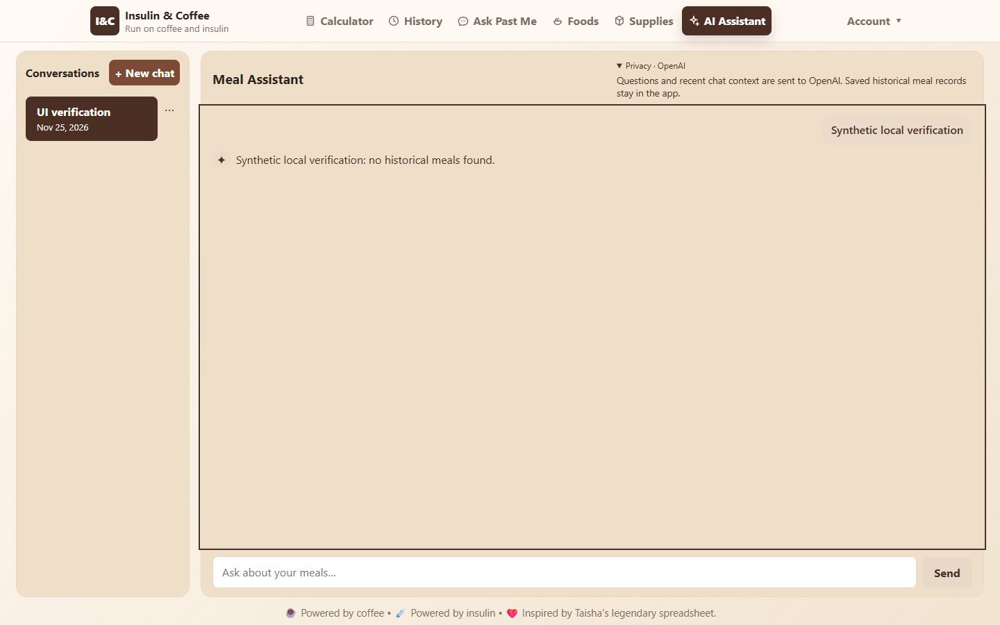
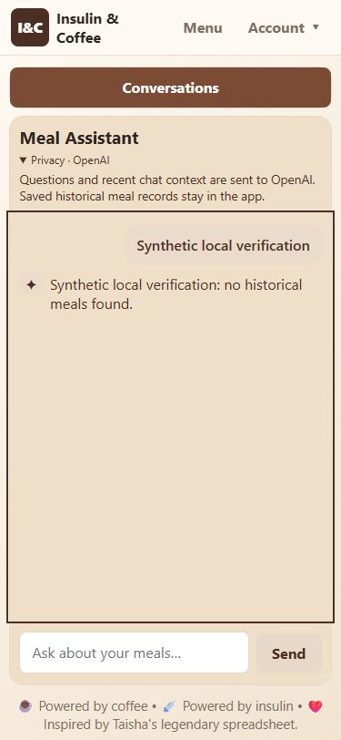
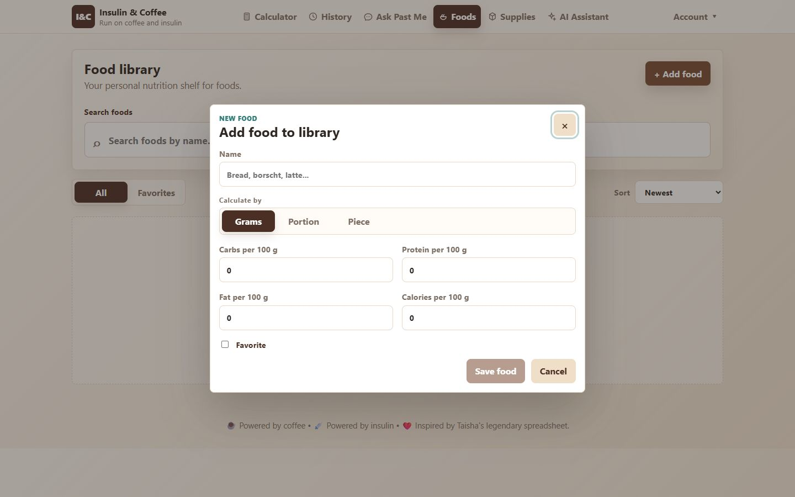
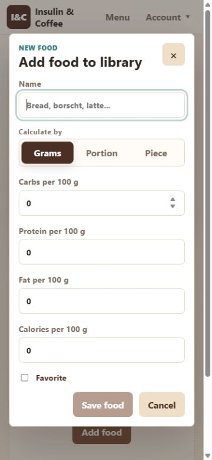
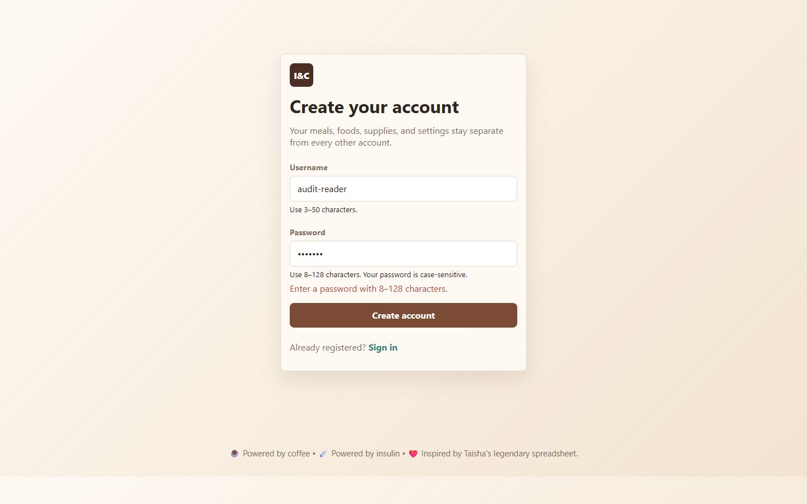
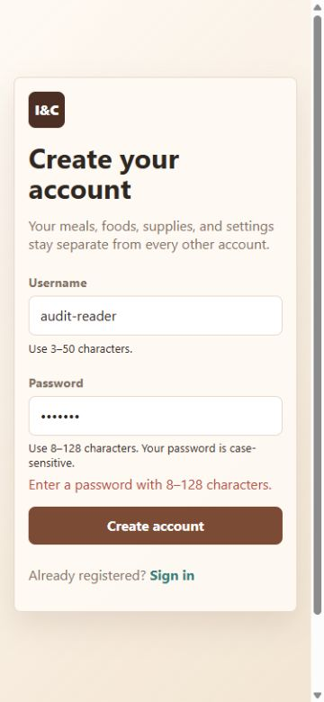
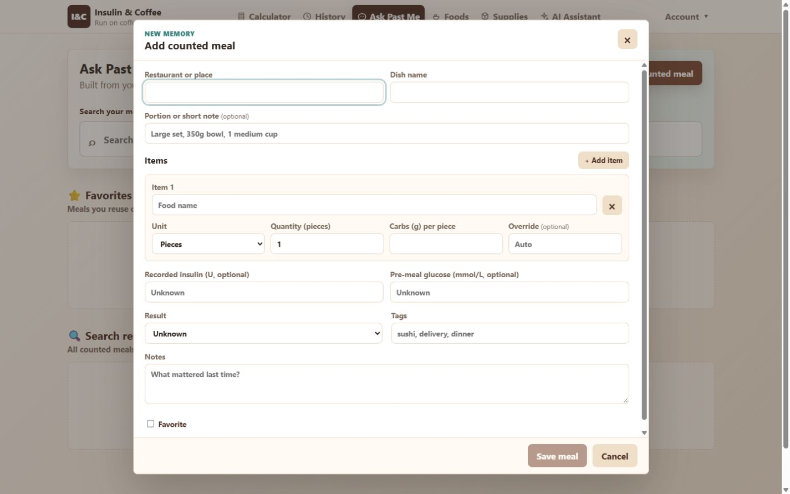
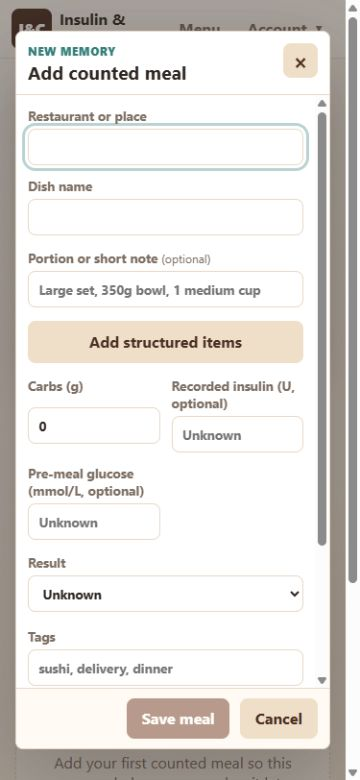

# UX audit fixes — 25 November 2026

Implemented from the complete audit report and its relevant registration, Foods,
Ask Past Me, assistant, navigation and surrounding-page screenshots. No backend,
API contract, calculation, matching, deduplication or database schema changes.

## Root causes and fixes

| Issue | Root cause | Fix |
| --- | --- | --- |
| Food editor keyboard focus | The overlay was an ordinary article with no dialog semantics or keyboard lifecycle. | Added a labelled modal dialog, initial Name focus, Tab/Shift+Tab containment, containment of programmatic outside focus, Escape, and restoration after close. Edit restores the visible overflow summary, rather than its now-hidden Edit button. |
| Assistant contrast | Global paragraph color and local muted text used `#7d6e63` on cream `#f0dfc8` (3.758:1). | Scoped existing `--coffee-dark` (`#4c2f24`) to replies, Privacy and other cream-backed informational text: **9.253:1**. Card metadata retains its existing passing palette. Disabled buttons now use solid line/background and dark coffee text: **8.655:1**, with native disabled semantics. Existing hover backgrounds retain dark text and keyboard focus has a 2 px dark coffee outline. |
| Wasted assistant height | Angular's empty router-outlet anchor was a direct grid child alongside the routed host, generating an extra row. | Shared `main > router-outlet { display: none; }` removes the nonvisual anchor from layout. Angular still renders the routed component normally. No negative margins, route changes or global page-width changes. |
| Registration validation | Form validity disabled submission without field requirements, inline errors or descriptions. | Initial username/password length hints, associated labels/descriptions, polite inline errors and aria-invalid. Submission marks invalid fields touched and retains values; only a pending request disables submission. Existing 3–50 / 8–128 validators and exact password bytes are preserved. Duplicate pending submissions are guarded. |
| Ask Past Me units/unknown values | Generic quantity/unit labels and unlabeled clinical units; unknown historical glucose displayed as zero. | Distinct grams, servings and pieces, quantity labels matching the selected unit, and carbs per serving/piece. Historical fields state g, U and mmol/L; optional insulin/glucose show Unknown when empty. Glucose form state is nullable, with the existing omission of nonpositive/absent glucose preserved. Saved quantities, units, overrides and confirmed carbohydrate totals are unchanged. |
| Food save feedback | Save lacked an in-flight guard and local error recovery. | Saving label, disabled/busy submit, duplicate submission guard and inline failure alert that retains entered data for retry. Closing waits for the pending save to finish. |

## Files changed

Production frontend:

- `frontend/src/app/shared/dialog-focus.directive.ts` — modal keyboard lifecycle.
- `frontend/src/app/pages/foods/foods.component.ts` — create/edit dialog and save recovery.
- `frontend/src/app/pages/auth/register.component.ts` — field guidance and validation.
- `frontend/src/app/pages/delivery-meals/delivery-meals.component.ts` — unit labels and empty historical glucose.
- `frontend/src/app/pages/meal-assistant.component.ts` — scoped text/disabled-state contrast.
- `frontend/src/styles.css` — nonvisual routing-anchor layout rule.

Regression tests:

- `frontend/src/app/app-layout.spec.ts`
- `frontend/src/app/pages/foods/foods-dialog.component.spec.ts`
- `frontend/src/app/pages/auth/register.component.spec.ts`
- `frontend/src/app/pages/delivery-meals/structured-orders.component.spec.ts`
- `frontend/src/app/pages/meal-assistant.component.spec.ts`

This report, screenshots and `route-checks.json` record verification. Pre-existing
skill changes and audit artifacts were preserved.

## Verification

- **149 frontend tests passed** in headless Edge. New regressions cover initial
  focus, both Tab boundaries, outside-focus containment, Escape restoration,
  Edit/Cancel restoration to the overflow trigger, delayed save deduplication,
  failure recovery, registration descriptions/errors, unchanged password bytes,
  successful post-registration navigation, saved units/carbs, computed text
  contrast and routed geometry at 375 and 1440 px.
- The shared-layout test uses the actual AppComponent and routing outlet, actual
  Meal Assistant, and representative normal-page content for every declared
  concrete route pattern. It checks the routing anchor has no layout box, normal
  main remains block layout, and the assistant begins immediately after padding.
- `npm run build`: **passed**. Existing component-style warning thresholds remain
  exceeded: Meal Assistant 7.23 kB and Ask Past Me 5.77 kB against 4.10 kB warnings.
  Error budgets were not changed.
- `git diff --check`: **passed**.
- Standard `npm test -- --watch=false --browsers=EdgeHeadlessNoSandbox` encountered
  the local Windows launcher issue: Edge connected but its launcher process exited
  early. Final execution used a temporary Karma config with `browsers: []` and
  installed Edge attached headlessly to localhost:9876. No project test-runner
  configuration was changed. Karma reported `TOTAL: 149 SUCCESS`; its shutdown
  also emitted a browser-disconnected message after all tests completed.

Browser checks used **375×812** and **1440×900** with a separate Development API
and disposable database `iac_ux_fixes_20261125` at `127.0.0.1:5433`. The assistant
reply was an explicitly labelled synthetic persisted fixture; no OpenAI call,
historical meal or insulin confirmation was created.

- Food editor: Name focused on opening; Shift+Tab on Close reached Cancel; Tab
  on Cancel wrapped to Close. Escape and Cancel restored Add food. Mobile dialog
  fit within the viewport. Edit restoration is additionally covered by regression.
- Assistant desktop: main top y=60.594, workspace y=72.594; the only main grid row
  is 787.406 px. The prior 146–187 px empty row is gone. Composer bottom y=859
  in a 900 px viewport.
- Assistant mobile: one main row of 679.406 px; composer bottom y=751 in an 812 px
  viewport. Document scroll width is 375 px. Reply and expanded Privacy text both
  compute to `rgb(76,47,36)` on `rgb(240,223,200)`.
- Privacy was checked expanded under the pointer and by keyboard; its text color
  stays dark. Keyboard navigation showed the existing 2 px dark coffee focus
  outline. Disabled Send uses dark text on `rgb(231,216,200)`, opacity 1.
- Registration: seven-character password displays the 8–128 error with
  aria-invalid=true and associated descriptions; input stays entered and submit
  remains available to explain invalid input.
- Ask Past Me: empty glucose/insulin displayed; selecting Pieces displayed
  Quantity (pieces) and Carbs (g) per piece. No test order was saved.
- Actual Calculator, History, Ask Past Me, Foods, Supplies, Settings, Dashboard,
  Not Found, Access Denied and Error pages were checked at both widths; routing
  anchors are hidden, main stays block layout, and no horizontal overflow was
  measured. Login and registration were also exercised. Admin-specific content
  and populated meal-detail content were not manually exercised; their shared
  routed shells are covered by the layout regression.

## UX acceptance checks — 375 and 1440 px

- **JAKOB-1:** modal controls remain native; dialog is labelled and keyboard focus
  enters, stays inside and returns to the visible opener.
- **POSTEL-2:** password requirements/security are unchanged; no password trimming
  or normalization.
- **POSTEL-4 / ACTIVE:** invalid registration input has nearby corrective guidance
  before and after submission, without losing entered values.
- **DOHERTY-1:** Food save shows actual pending state, guards duplicates and retains
  input after failure; delayed-response behavior is tested, not claimed as a
  production latency measurement.
- **MMODEL:** quantities show grams/servings/pieces separately from carbohydrate
  grams; no conversion or reinterpretation of user-confirmed values was added.

## Remaining scope and limitations

Optional 44 px touch-target comfort improvements from audit finding 7 were not
included; the audit established that those controls already pass the 24 px AA
minimum. Duplicate Good result labels still require a product decision. No full
screen-reader certification, physical-phone keyboard check, production telemetry
or live LLM behavior is claimed. No commit was created.

## Screenshots

